<a href="https://www.lavanshchoubey.site"></a>

  
  
  


  <a href="https://www.lavanshchoubey.site/#work"></a>
  <a href="https://www.lavanshchoubey.site/#work"></a>
  <a href="https://www.lavanshchoubey.site/#work"></a>
  <a href="https://www.lavanshchoubey.site/#work"></a>
  <a href="https://www.lavanshchoubey.site/#work"></a>
  <a href="https://www.lavanshchoubey.site/#work"></a>

<b>More work</b> · RAKSHA X, Pravah.ai, Stock_Verse, Peer-Point

 

| # | Project | What it does | Built with |
|:-:|---|---|---|
| 07 | **[RAKSHA X](https://github.com/lavansh1306/RAKSHA_X)** | Personal safety app: YAMNet hears gunshots or breaking glass, Vosk hears panic words, and a WhatsApp SOS goes out with live location and an audio clip. | Flask · TensorFlow · Vosk · Twilio · Gemini |
| 08 | **Pravah.ai** | Turns long Slack threads into tasks, owners, blockers and deadlines, with JSON Schema checks and a fallback when the AI call fails. | TypeScript · Slack API · LLM APIs · Vercel |
| 09 | **[Stock_Verse](https://github.com/lavansh1306/Stock_Verse)** · [live](https://stock-verse-nine.vercel.app) | Learn the stock market by playing: live charts, a trading simulator, quizzes, XP and a Gemini assistant. | React · TypeScript · FastAPI · Flask · Gemini |
| 10 | **[Peer-Point](https://github.com/lavansh1306/Peer--Point)** | Doubt-solving platform with threaded answers, subjects and JWT role-based access. | React · TypeScript · Spring Boot · PostgreSQL |


<a href="https://www.lavanshchoubey.site/#experience"></a>

<a href="https://www.lavanshchoubey.site/#podium"></a>


  
  

  <b>Certified:</b> Oracle Cloud Infrastructure 2025 Generative AI Professional · OCI 2025 AI Foundations Associate

<a href="https://www.lavanshchoubey.site/#contact"></a>

Plain-text version

 

**Lavansh Choubey** — full-stack & AI engineer. B.Tech CSE at SRM IST (2024 – 2028). AI Engineering Intern at C-DAC Guwahati (Oct 2026 – Feb 2027).

- **Projects:** PRAPTI-AI · SAHAYAK-AI · Incident Triage Agent · Sephela · Velocity AI · TANFI-NET · RAKSHA X · Pravah.ai · Stock_Verse · Peer-Point
- **Experience:** C-DAC Guwahati (AI Engineering Intern) · Niramaya Health Tech (Software Engineering Intern, Mar – Oct 2025)
- **Leadership:** PLACFV’s, SRM’s placement team — Volunteer → Associate Head → Lead, Corporate Group · 50+ drives · 20+ volunteers
- **Hackathons:** 8 podium finishes (3 wins) · ₹25K+ in prizes · FinShield finalist at IIT Hyderabad
- **Contact:** lavansh1201a@gmail.com · [LinkedIn](https://www.linkedin.com/in/lavansh-choubey-683355314/) · [lavanshchoubey.site](https://www.lavanshchoubey.site)

